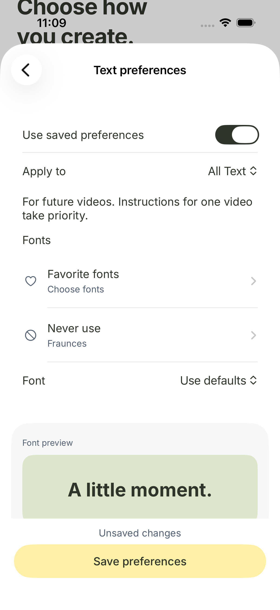

# KRI-648 iPhone preferences repair

## Request and acceptance

The creator could not retain font selections or save preferences. The screen showed counts returning to zero and the error "The data couldn't be read because it is missing." The creator also asked for a clearer, less text-heavy screen. The concrete case is excluding Fraunces from future video text.

A passing settings journey selects Fraunces, returns from the picker with that name visible, saves, leaves settings, reopens settings and finds Fraunces still selected. Switching text types must retain each unsaved draft. Stale writes must keep the draft and offer Reload. This local fix does not establish that the creator's production account has saved the rule or that a new production export honors it.

## Failure inventory before implementation

- Mutation succeeds in storage, but iPhone decoding fails because it requires `id` instead of the API's `operation_id`.
- A later read fails on the same mismatch in non-null `recent_undo`.
- Returning from font navigation repeats page loading and replaces the draft with stored choices.
- Changing text type discards unsaved choices, or writes a draft to the wrong scope.
- A required font is also excluded, or a font is both favored and excluded.
- A fixture invents an `id` response and masks the production contract error.
- A failed save clears the draft or falsely reports success.
- New UI tests are absent from the separate UI group inventory, forcing the selector into full fallback and failing its self-checks before a release build.

## Boundaries and design

`TextPreferenceRule` remains the per-role data shape. The view owns a dictionary of unsaved drafts by role. It loads from the server only on initial entry, preserves the current draft during font navigation and reloads canonical values only on explicit recovery/reset. Mutations retain the existing revision and idempotency protections.

`TextPreferenceOperation` decodes `operation_id` for both mutation results and recent Undo. The URLProtocol fixture uses the actual API response field names. It replaces network storage for the native UI proof, so these results do not claim production persistence.

The settings form shows font samples, the names of selected fonts, a Never use row, searchable font lists and color swatches. Save remains visible at the bottom. Learning details follow the explicit settings. Existing preferences API and renderer precedence are unchanged.

## Native reproduction

The original app was built on an owned iPhone 17 simulator running iOS 26.5 with the corrected API-shaped transport fixture. `testTextPreferenceDraftSurvivesRoleSwitch` failed with "Changing scope must retain the unsaved draft". `testTextPreferencesSaveOffEffectsAndReopen` failed to show the Saved confirmation, then failed to load settings. Its captured accessibility hierarchy contains "The data couldn’t be read because it is missing." This verifies the reported error on the same native surface.

The first exclusion test attempt failed because its test selector did not find the scrolled font row. That result is a harness failure, not evidence of selection loss. The selector was corrected before the final verification.

## Verification

The API-shaped Swift decoding check passed. The mapped backend run passed all 22 checks against this worktree's isolated migrated database. The journey-gate tests passed all six checks. The final native result passed all eight selected tests with zero failures and zero skips. These include seven settings/chat journeys and the existing export test covering all 27 typography cases. The CI coverage verifier confirmed all eight named tests actually passed.

The final native input fingerprint is `e7f9580cc7d1e9c9f22bd7f5a6decc504f17e2550c56a86c96dcb607bc715543`, matching the final source contents. The app implementation is commit `800c2a94927c88d061f6e9a4122c7b433f55d207`; the final helper and this report are committed afterward without changing app behavior. The successful local bundle is `.dev/verify-kria-ios/verified.xcresult`. CI retains fresh artifacts for the PR head through the mapped journey job.

The first neighboring-case run found that a moved learning control needed scrolling back to the scope selector. A later run caught partly occluded learning controls near the pinned Save area. The audit measured Accept at y=745 with a 44-point height and Save starting at y=780. The action's frame extended under the bar. The isolated audit replay passed the same acceptance and persisted-title assertions. The UI helper now scrolls body controls fully above the pinned action area instead of relying only on isHittable. Temporary tap instrumentation was removed.

The initial backend attempt had nine local socket-permission setup errors. It was rerun with an isolated task database and local socket access; the final backend run has no failures or skips.

## Limits

No production account, model provider or release deployment was used for the repair. No generated edit or timeline behavior changed. Production rollout and the creator's real account-to-export journey remain pending under KRI-648. An updated iPhone build is required; the previously enabled server flags cannot repair the installed client's decoder or draft lifecycle.

## Repeatable checks

Build in a task-owned simulator with `bash .agents/skills/verify-kria-ios/scripts/verify.sh launch`. The selected native run uses the generated `.dev/phone-text-style` input from `src/apps/api/.venv/bin/python scripts/ios/phone-text-style-e2e.py .dev/phone-text-style`.

Run `xcodebuild test-without-building` with the Kria project/scheme, the owned simulator, its existing build directory, `-parallel-testing-enabled NO`, and these exact selections. Set `TEST_RUNNER_KRIA_E2E_DIR` to the generated input directory.

- `KriaTests/DeviceMontageRenderE2ETests/testGenerationPinnedTextStylesPreviewAndExport`.
- `KriaUITests/AccountPrivacyUITests/testExcludedFontSurvivesPickerReturnSaveAndReopen`.
- `KriaUITests/AccountPrivacyUITests/testTextPreferenceDraftSurvivesRoleSwitch`.
- `KriaUITests/AccountPrivacyUITests/testTextPreferencesSaveOffEffectsAndReopen`.
- `KriaUITests/AccountPrivacyUITests/testTextPreferencesStaleWriteKeepsEditsAndOffersReload`.
- `KriaUITests/AccountPrivacyUITests/testFinishedEditLearningConsentAcceptAndDisableKeepsApprovedPreference`.
- `KriaUITests/AccountPrivacyUITests/testFinishedEditLearningDismissAndResetHistory`.
- `KriaUITests/CreationUITests/testFinishedEditLearningChatAcceptAndDismiss`.

Backend verification used `bash scripts/check-api.sh test tests/pipeline/test_phone_text_style.py tests/evals/test_phone_typography_evals.py tests/integration/test_finished_style_learning.py -q`. Journey wiring used `src/apps/api/.venv/bin/python -m pytest scripts/ci/test_journey_gate.py -q`.

The new settings journeys are selected and fail-closed verified by the existing `kri-648-phone-text` CI job. There is no web UI implementation or browser verification in this change. New model calls, prompts, paid evaluations and media selection are not involved, so a wrong-content export control is not applicable to this local settings repair.

## Reviewed screen

The screenshot uses a synthetic account fixture and shows the actual native view. It contains no production account data.

## Review process

Work stayed in this agent under the user's no-delegation instruction. Fix Root Causes corrected the wire contract and page-loading behavior. Model the Domain selected a per-role draft dictionary. Prove It Works required native save/reopen and the mapped export checks. Attack the Premise led to recording tap geometry before changing the learning-control check. The cursor-team-kit deslop skill is not installed; the diff received a manual simplicity and comment review instead.

## Release CI inventory correction

After the authorized admin merge of #1895, main's iOS workflow stopped in its selector self-checks before compilation. The two new AccountPrivacy tests were in the journey manifest but absent from `scripts/ios/ui-test-groups.json`. The inventory comparison therefore forced full fallback, and four focused-selector assertions failed. This was reproduced locally before changing the inventory.

Adding those two names to the existing creation group restored the exact CI gate: `python3 -m unittest discover -s scripts/ci -p 'test_*.py' -v` passed all 121 tests. The native source fingerprint remains `e7f9580cc7d1e9c9f22bd7f5a6decc504f17e2550c56a86c96dcb607bc715543`, so the previously passing app and native UI evidence still covers the binary inputs. No assertion or selector fallback policy was relaxed.

Failure-mode coverage: an unclassified UI test is caught by `inventory_matches` and the focused-selection self-checks; a missing workflow test selection is caught by the journey gate; response decoding and retained drafts remain covered by the eight native checks listed above. App Store upload, processing and tester availability still require direct release evidence.
