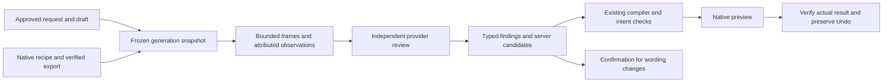

# Intent-aware review: design contract

Review the creator's request against the approved edit and the actual output, fix recoverable execution problems within that intent, and offer useful previews or suggestions. Restoring authoritative wording is allowed; changing the creator's wording requires confirmation. Selected footage, music, explicit timing and do-not-touch fields stay protected.

The timing-repair reviewer (`WORK.md`) only corrects a preapproval draft from proposed operations. It never sees the approved plan, the recipe or pixels. The review described here judges the finished video.

## Contract

1. **Frozen inputs.** Capture them from the exact accepted runtime execution: its approved draft and hash, dispatch-time `BriefBinding` and full request, ownership epoch, native recipe identity, winning published attempt and server-verified artifact identity (`render_review_context.py`). Missing authority or artifact identity means unavailable, never a substituted latest draft or a client-claimed hash.
2. **One admission per generation.** The runtime observer's publication transaction records an idempotent generation-scoped request and enqueues after commit, with reconciliation for a lost enqueue. Publication and the playable output never depend on the review. The legacy thread GET must not create a competing review.
3. **Bounded evidence.** Claim under locks, copy the approved inputs, release the locks, then decode selected frames from the verified winning export using the actual-byte publication proof. Keep frame timestamps, hashes, the source digest and the extraction version. Audio claims need independently supplied audio evidence. Never claim that unseen intervals or audio were inspected (`RENDER_REVIEW_EVIDENCE.md`).
4. **Separate media contract.** A separately priced provider contract sends the request, requirements, plan, recipe and bounded frames. The text adapter keeps rejecting media. Cost is reserved before any transfer. Never forward a Gemini upload URI to another provider.
5. **Typed findings only.** The model returns findings that reference server-built candidate and frame-evidence IDs. It supplies no executable operations, wording or authority. A subjective improvement is a suggestion. A wording change is a confirmation question. Restoring exact authoritative copy may be staged without asking again.
6. **Reversible repair.** An eligible correction compiles through the current draft and compiler path, preserves the prior good output and Undo, and is verified against the frozen request and evidence. A proposal is never reported as an applied or verified improvement.

## Acceptance gates

- The runtime submit, approval and native-publication path produces exactly one review request per generation, independent of GET ordering. Duplicate delivery, worker crash and lost enqueue never duplicate a paid call.
- The original prompt, approved draft, full recipe and evidence come from that execution even if later chat, drafts or ownership change. A stale generation, altered recipe, wrong artifact or transferred ownership cannot send or apply review work.
- A wrong-content control is detected from supplied visual evidence. A text-only packet cannot claim visual inspection and a frame-only review cannot claim audio inspection. Missing or corrupt media stays explicit while the previous usable output survives.
- Exact wording, selected footage and music, intentional overlap and do-not-touch fields survive. Changing wording asks for confirmation.
- Rejected or unsupported proposals, missing assets, repeated failure, exhausted budget or deadline, an ambiguous outcome and a worsening repair all terminate within bounds. There is no unlimited judge or retry loop.
- Feedback describes verified applied changes, labels incomplete previews and exposes Preview and Undo.
- Qualification measures completion, instruction fidelity, missed violations, false fixes, latency and cost. A different provider is not a correctness guarantee.

## Evidence rules

Offline tests may replay only provider transport and billing. They use the real input capture, ownership checks, planner, parser, compiler and native renderer wherever they claim to. Live qualification needs a separately authorized, isolated synthetic run with a fixed model, an approved run ID, a monetary cap, a one-call policy and preregistered controls. Phone acceptance separately proves the intended binary, backend revision, exact generation, original media, wording and Undo.
