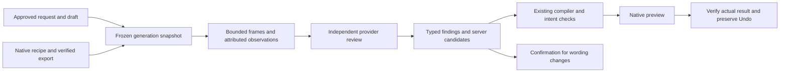

# Intent-aware review: remaining integration

PR #1953 corrects one preapproval compiler failure: an unrequested copy mutation inside a timing-only draft. It does not implement the requested review of a finished video. Its model receives proposed operations, a fixed candidate and a compiler observation; no approved plan, full recipe, pixels, audio or video bytes.

The original goal remains: review the user's request against the approved edit and the actual output, fix recoverable execution problems within that intent, and offer useful previews or suggestions. Restoring authoritative wording is allowed; changing the user's wording requires confirmation. Selected footage, music, explicit timing and do-not-touch fields remain protected.

## Current execution boundary

Runtime-v2 settles publication in `tasks/kria_runtime.py::_observe_dispatched_execution`. Its `_approved_generation_review` is deterministic requirement/recipe reporting. It does not queue a video-model review. A full thread GET can incidentally call legacy `reconcile_render_state`, which may queue Gemini before the observer settles; the opposite order can skip that queue. This race is not a canonical current-runtime review controller.

The legacy Gemini grader sends an MP4 with the fixed rubric, without the approved request and plan. The existing OpenAI/Claude adapter is explicitly text-only and rejects media. Its Gemini upload URI must never be forwarded to another provider.

## Implementation sequence

1. Capture immutable inputs from the exact accepted runtime execution: its approved draft and hash, dispatch-time BriefBinding and full request, ownership epoch, native recipe identity, winning published attempt and server-verified artifact identity. `render_review_context.py` is the first follow-up unit. The first unit supports editor-render approvals carrying an explicit native recipe revision; initial renders need a separate authoritative adapter. It neither calls a provider nor mutates a project. Missing authority or verified artifact identity means unavailable, never a substituted latest draft or client-claimed hash.
2. Add canonical, durable admission in the runtime observer's successful publication transaction. Store an idempotent generation-scoped review request; enqueue after commit with retry/reconciliation for a lost enqueue. Publication and the existing playable output remain independent of review. The legacy GET path must not create a competing review.
3. Claim under locks, copy the approved inputs, release locks, then obtain bounded evidence from the verified winning export. Reuse #1939's actual-byte publication proof. Decode selected frames from that MP4; this is analysis, not server final rendering. Preserve frame timestamps and hashes, source video digest, extraction version and sampled intervals. Audio claims need independently supplied audio evidence. Store no claim that unseen intervals or audio were inspected.
4. Add a separately priced, explicit frame/media provider contract. Send OpenAI the original request, approved requirements and plan, native recipe and bounded actual frames, plus clearly attributed existing observations. Keep the text adapter's media rejection intact. Verify the selected model's media capability and pricing before qualification; reserve before media transfer. Do not silently switch every app review model.
5. Parse typed findings with evidence references, unmet requirement IDs, confidence and server-defined repair/suggestion candidate IDs. The model supplies no executable scripts or authority. A subjective improvement is a suggestion; a wording change is a confirmation question. An execution correction may restore exact authoritative copy without asking again.
6. Compile an eligible correction through the current draft/compiler path, preserve a prior good output and Undo, create a native preview, then verify the result against the frozen request and evidence. Report what actually changed and why. A proposal is not an applied or verified improvement. Post-render automatic edits need a represented instruction-preserving authority grant; the existing source-normalization-only grant cannot stand in for that contract. Encode the user's authorized safe-repair scope rather than asking for each routine correction again.

## Acceptance gates

- The actual runtime submit/approval/native-publication path produces exactly one review request for a generation, independent of GET ordering. Duplicate delivery, worker crash and lost enqueue do not duplicate paid calls.
- Original prompt, approved draft, full recipe and evidence come from that execution, even if later chat, drafts or ownership change. Stale generation, altered recipe, wrong artifact and transferred ownership cannot send or apply review work.
- A wrong-content control is detected from supplied visual evidence. A text-only packet cannot claim visual inspection. Frame-only review cannot claim audio inspection. Missing or corrupt media remains explicit while the previous usable output survives.
- Exact wording, selected footage/music, intentional overlap and do-not-touch fields survive. Changing wording asks for confirmation. Recoverable timing/placement corrections match the actual approved intent and pass the real parser/compiler/native path.
- Rejected or unsupported proposals, missing assets, repeated failure, exhausted budget/deadline, ambiguous outcome, difficult duration fit and a worsening repair all terminate within bounds. No unlimited judge/retry loop.
- Feedback describes verified applied changes, labels incomplete previews and exposes Preview/Undo. No dropped instruction is hidden to force a success score.
- Measure completion and instruction fidelity, missed violations, false fixes, latency and cost. Compare provider blind spots with controlled cases; a different provider is not a correctness guarantee.

## Qualification and rollout

Offline tests may replay only provider transport and billing; they must use the real input capture, ownership checks, planner/parser/compiler and native renderer where claimed. Then run a separately authorized, isolated synthetic qualification with a fixed model, approved run ID, monetary cap, one-call/retry policy and preregistered success/failure controls. Inspect its actual before/after artifacts. Live qualification is not currently authorized by this document and does not activate production.

Phone acceptance must separately prove the intended TestFlight binary, backend revision, exact generation, original media, wording and Undo. A synthetic primitive export, schema test or green API CI does not establish that acceptance. Keep all new provider gates off until scoped authority, pricing, credit attribution and qualification evidence are in place. No new credentials, broad paid activation or original-user-project development mutation is included.

## First-unit evidence

The read-only packet unit passes 20 tests, independently repeated, including real PostgreSQL runtime drafting, approval, prepared execution and native recipe preparation before capture. Capture leaves persisted state unchanged. Publication and byte-verifier receipts in that test are synthetic internal inputs, not an exported-file or direct visual-review claim. The canonical producer hook, #1939 verifier adapter, initial-render adapter, actual media extraction/provider transport and native result acceptance remain open.

## Canonical evidence admission implementation

The `codex/intent-review-runtime` follow-up implements steps 2 and 3 behind `KRIA_INTENT_REVIEW_ENABLED`, default off. It consumes #1939's existing generation-bound publication proof rather than duplicating its verifier. Both editor and initial strategy approvals resolve their exact prepared execution, approved binding, recipe, published attempt and final persisted dispatch settings. No current-state substitution is allowed.

The successful observer transaction records a pending admission demand before its fallible admission savepoint. Bounded reconciliation recovers a lost outbox insert or broker publication. Ownership or generation changes make the work stale. Three attempts, expiring worker leases and unique generation identities bound recovery. Publish attempts rotate by a durable timestamp so an undrained or failing broker cannot starve newer entries behind the first batch. Missing native metadata reports advisory unavailability without blocking readiness. Evidence extraction runs without database locks; a final locked input-digest check rejects state changed during decoding. The finished video stays playable regardless of review availability.

The artifact adapter reads the exact storage generation and checks actual streamed size and SHA-256 against publication proof. A nonroot Linux child applies hard memory, CPU, file, descriptor and process limits before FFmpeg/FFprobe. Parent output and wall time are bounded, external MOV references are disabled, and process groups are cleaned up. At most six JPEG frames retain artifact hashes and timestamps. Unsupported platforms fail closed before reading storage. This is headless analysis of an existing native export, not server final rendering.

The durable result is `evidence_ready`, never `reviewed` or `fixed`. No provider receives these frames yet. Provider media transport, pricing/reservation, typed findings, instruction-preserving repair authority, native correction previews and phone acceptance remain open. Existing paid gates and budgets are unchanged.

Portable author qualification passes 149 tests, including actual PostgreSQL observer, admission faults, reconciliation, ownership, duplicate, lease and dispatch-setting controls. Six frame integration cases were deliberately deselected on Darwin. Full decoder qualification, including actual Linux hard-limit controls, is pending the existing Ubuntu free-regression workflow. Historical Mac decoder results do not qualify this hardened version.

### First Linux qualification results

The isolated decoder at `982c25729b4c60358c0ffe8b3caba6d24a14cddf` passed [Ubuntu run 41077807872](https://github.com/emirerben/nova/actions/runs/41077807872). Its retained JUnit report has 20 decoder controls passed with no skips, within 709 total passed and two unrelated skips. Actual pixels/timestamps/provenance, replaced and corrupt bytes, memory refusal, output flood caps, file-size enforcement and process timeout cleanup all ran. The decoder source hash matches this canonical branch exactly.

Canonical run 41078179538 at `a5c7d88ea` passed 761 tests and failed six before extraction. The six frame-fence tests still expected duplicate admission to return an enqueue ID, although durable admitted markers now correctly return no new work. The test correction requires no duplicate enqueue plus exactly one existing pending row with the original ID. Production admission code is unchanged. Actual editor frame/final-fence qualification remains pending a corrected exact-head rerun; the initial approval/frame capture test passed in that run.
